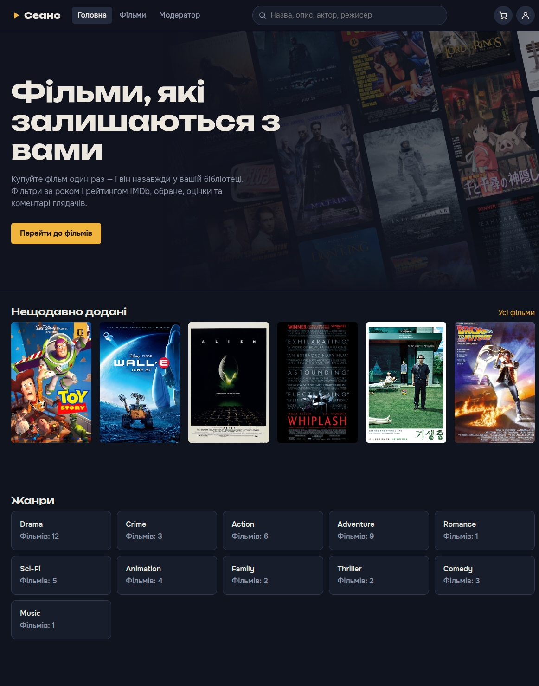
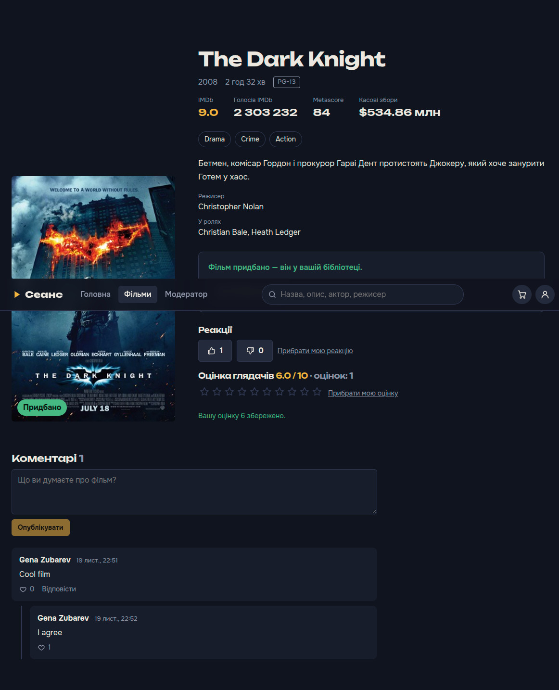
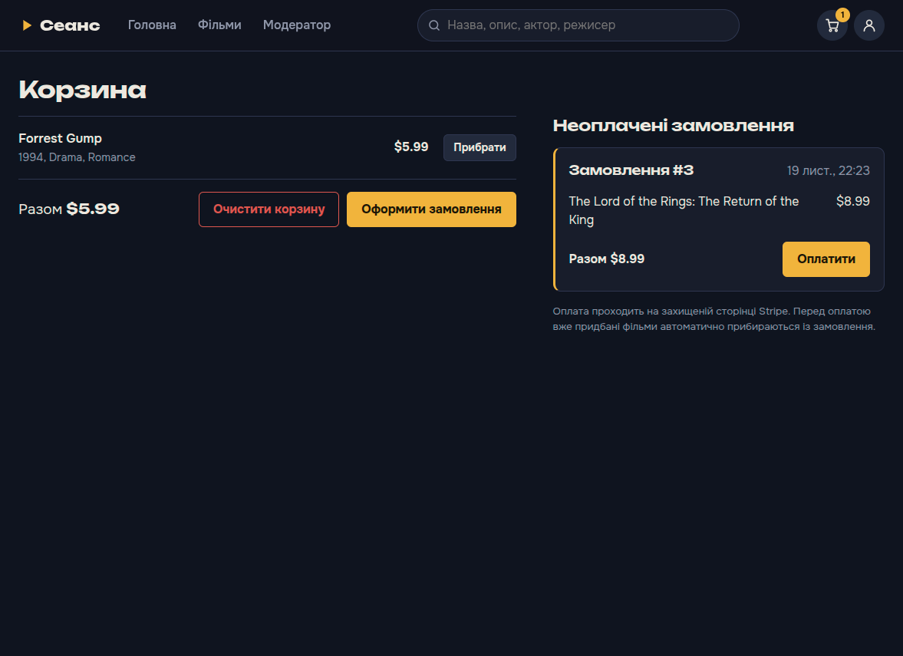
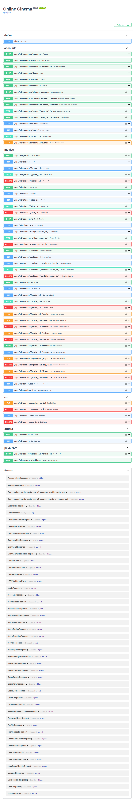

# Online Cinema

An online cinema: users register, browse a movie catalog, add movies to a cart
and buy them through Stripe. Moderators manage the catalog, admins manage users.

Monorepo: FastAPI backend + React frontend. Locally the whole stack runs with
Docker Compose; in production it runs on AWS EC2 behind nginx with HTTPS and is
deployed automatically after every merge to `main`.

**Live demo: [zubarev-cinema.duckdns.org](https://zubarev-cinema.duckdns.org)**



## Try the live demo

1. Register with a real email address — the activation link arrives by email.
2. Add a movie to the cart, place the order and pay. Payments run in **Stripe test
   mode**: card `4242 4242 4242 4242`, any future date and CVC, no real money is
   charged.
3. After payment the movie appears in **Purchased** and a receipt is emailed.

Moderator and admin roles (catalog management, user groups) are available on the
demo as well — access is given on request.

## Features

- **Accounts** — registration with email activation (link valid 24 h, can be resent),
  JWT login (access token + refresh token in an httpOnly cookie), logout, password
  change and reset by email, profile with avatar.
- **Roles** — `user`, `moderator` (+ catalog management), `admin` (+ user groups,
  manual activation and deactivation).
- **Catalog** — pagination, filters (year, IMDb, genre), sorting (price, year,
  popularity, IMDb), search by title, description, actor and director; genres with
  movie counts.
- **Movie page** — likes / dislikes, 1–10 rating, comments with replies and comment likes,
  favorites.
- **Cart → order → payment** — purchased movies cannot be added again, the order keeps
  the price at the time of ordering, payment via Stripe Checkout, confirmation by
  Stripe webhook, email receipt, "Purchased" list.
- **Moderator panel** — movies (with posters), genres, actors, directors,
  certifications; a purchased movie cannot be deleted.
- **Background tasks** — Celery sends emails; Celery Beat removes expired tokens and
  abandoned unpaid orders.

## Tech stack

| Part | Technologies |
|---|---|
| Backend | Python 3.12, FastAPI, SQLAlchemy 2 (async) + Alembic, PostgreSQL, Pydantic v2 |
| Background | Celery + Celery Beat, Redis |
| Payments | Stripe Checkout + webhooks |
| Files | MinIO (S3 API, boto3) — avatars and posters |
| Email | Mailpit (development), Gmail SMTP (production) |
| Frontend | React 19, TypeScript, Vite, React Router, TanStack Query, CSS Modules |
| Quality | pytest (coverage ≥ 95 %), flake8, black, mypy (strict); ESLint, Prettier |
| Infrastructure | Docker Compose, nginx, Let's Encrypt, AWS EC2, GitHub Actions (CI + CD) |

## Screenshots

| Catalog | Movie page |
|---|---|
|  |  |

| Cart and unpaid orders | Stripe Checkout |
|---|---|
|  |  |

| Purchased movies | Moderator panel |
|---|---|
|  |  |

**API documentation (Swagger UI, development)**



---

## Part 1 — Running locally

### Requirements

- Docker with Docker Compose;
- for payments — a free [Stripe](https://stripe.com) account (test mode) and the
  [Stripe CLI](https://docs.stripe.com/stripe-cli);
- for running tests and linters outside Docker — Python 3.12 + Poetry and Node.js 22.

### 1. Environment file

```bash
cp backend/.env.sample backend/.env
```

In `backend/.env` set:

- `SECRET_KEY` — a long random string:
  `python3 -c "import secrets; print(secrets.token_urlsafe(64))"`
- `STRIPE_SECRET_KEY` — your `sk_test_…` key (Stripe Dashboard → Developers → API keys);
- `STRIPE_WEBHOOK_SECRET` — see [Payments in development](#5-payments-in-development).

The rest of the values work for local development as they are.

### 2. Start the stack

```bash
docker compose up -d --build
```

Migrations run automatically (the one-shot `migrate` service), including the
`user` / `moderator` / `admin` groups. The backend and the frontend run with hot
reload: the code is mounted into the containers.

### 3. Create the first admin

```bash
docker compose exec web python -m commands.create_admin admin@example.com
```

Asks for a password (same rules as registration: 8+ characters, an uppercase and a
lowercase Latin letter, a digit and a special character). If the user already exists,
it becomes an active admin and keeps its password.

### 4. Demo data (optional)

```bash
docker compose exec web python -m commands.seed_movies
```

Adds 20 movies with genres, directors, actors and posters
(`backend/commands/seed_posters/`). Safe to run again: existing movies are skipped.

### 5. Payments in development

Stripe cannot reach `localhost`, so the Stripe CLI forwards webhook events:

```bash
stripe login
stripe listen --print-secret        # put this value into STRIPE_WEBHOOK_SECRET
docker compose up -d web            # re-read .env (restart does not)
stripe listen --forward-to localhost:8000/api/v1/payments/webhook
```

Keep `stripe listen` running while testing payments. Test card: `4242 4242 4242 4242`,
any future date and CVC. Without the webhook the payment succeeds in Stripe, but the
order stays unpaid on the site.

### Addresses

| What | URL |
|---|---|
| Website | http://localhost:3000 |
| API | http://localhost:8000/api/v1 |
| Swagger UI / ReDoc | http://localhost:8000/docs · http://localhost:8000/redoc |
| Mailpit (all outgoing emails) | http://localhost:8025 |
| MinIO console | http://localhost:9001 (`MINIO_ROOT_USER` / `MINIO_ROOT_PASSWORD`) |

In development every email (activation, password reset, payment receipt) goes to
Mailpit, not to a real mailbox.

### Tests and checks

Backend (from `backend/`, needs the `db` container and a test database once):

```bash
docker compose exec db createdb -U cinema cinema_test
poetry install
poetry run pytest --cov
poetry run flake8 . && poetry run black --check . && poetry run mypy .
```

Frontend (from `frontend/`):

```bash
npm ci
npm run lint && npm run format:check && npm run build
```

The same checks run in GitHub Actions on every pull request.

---

## Part 2 — Production

### Architecture

One AWS EC2 instance (`t3.micro`, Ubuntu) runs the whole stack with
`docker-compose.prod.yaml`. Only nginx is reachable from the internet; the
database, Redis and MinIO are available only inside the Docker network.

```
            HTTPS (443) / HTTP (80 → redirect)
Browser ───────────────────────────────────► nginx  (container: built SPA + reverse proxy)
                                               ├── /           → static React build (SPA fallback to index.html)
                                               ├── /api/       → web    (FastAPI, uvicorn)
                                               └── /avatars/   → minio  (avatars and posters, presigned URLs)

web ──► PostgreSQL · Redis · MinIO          worker (Celery) ──► Gmail SMTP
beat (Celery Beat) ──► Redis                Stripe ──webhook──► /api/v1/payments/webhook
```

- **Images** — `backend/Dockerfile.prod` (multi-stage: runtime dependencies only,
  non-root user; one image for web / worker / beat / migrations) and
  `frontend/Dockerfile.prod` (Vite build → static files in `nginx:alpine`).
- **nginx** (`frontend/nginx/default.conf.template`) — TLS termination, HTTP → HTTPS
  redirect, long-term caching of hashed assets, rate limiting of login /
  registration / password-reset endpoints, upload size limit.
- **HTTPS** — Let's Encrypt certificate issued by certbot on the host and renewed
  automatically (webroot challenge served by nginx, no downtime; nginx reloads after
  renewal).
- **Data** — PostgreSQL and MinIO data live in Docker volumes and survive redeploys.
- **Email** — a dedicated Gmail account (SMTP with an app password).
- **Payments** — Stripe in test mode; events arrive at a webhook endpoint registered
  in the Stripe Dashboard and are verified by signature.

### Continuous deployment

```
pull request ──► CI (Backend / Frontend: lint, types, tests, build)
merge to main ──► CI on main ──green──► Deploy workflow ──SSH──► deploy.sh on EC2
```

- `.github/workflows/deploy.yml` starts after a successful CI run on `main`
  (or manually, for changes outside `backend/` and `frontend/`).
- [`deploy.sh`](deploy.sh) pulls `main`, rebuilds the images, restarts the stack
  (migrations run before the API starts) and removes old images.
- The SSH key used by GitHub Actions is restricted on the server to this single
  script — it cannot open a shell or run other commands.

### Configuration and secrets

No secrets are stored in the repository. The server keeps two files that are not
in git:

- `.env` — the domain for nginx (template: [`.env.prod.sample`](.env.prod.sample));
- `backend/.env` — application settings and secrets
  (template: [`backend/.env.prod.sample`](backend/.env.prod.sample)).

GitHub Actions secrets hold only the SSH connection data for the deploy workflow.

### Security notes

- Server access only by SSH keys (password login disabled).
- Refresh token in an httpOnly, `Secure`, `SameSite=Lax` cookie; access token kept
  in memory on the client.
- Passwords hashed with Argon2; activation / reset / refresh tokens stored as
  SHA-256 hashes.
- Refresh tokens are rotated on every use; reuse of an already rotated token is
  treated as theft and revokes all sessions of the user.
- Deactivating a user takes effect immediately: access tokens stop working and all
  refresh tokens are revoked.
- Uploaded images (avatars, posters) are checked by their content with Pillow, not by
  the client's `Content-Type`.
- Swagger UI is available in development only: in production nginx exposes just
  `/api/`.

---

## Project management

The work was planned and tracked on a Trello board: one card per step, labeled by
module (Accounts, Movies, Tests, Frontend, …), moved ToDo → In progress → Done.


## Project structure

```
online-cinema-service/
├── backend/
│   ├── src/                  # accounts, movies, cart, orders, payments, storage, emails, tasks
│   ├── alembic/              # migrations
│   ├── commands/             # create_admin, seed_movies (+ seed_posters/)
│   ├── tests/                # unit + integration
│   ├── Dockerfile            # development image
│   └── Dockerfile.prod       # production image
├── frontend/
│   ├── src/                  # React SPA (see frontend/README.md)
│   ├── nginx/                # production nginx config
│   ├── Dockerfile            # development image (Vite dev server)
│   └── Dockerfile.prod       # production image (build + nginx)
├── docker-compose.yml        # development stack
├── docker-compose.prod.yaml  # production stack
├── deploy.sh                 # production deploy (run by GitHub Actions)
└── .github/workflows/        # backend.yml, frontend.yml (CI), deploy.yml (CD)
```

## Notes

- The project covers a selected part of the original specification: the full path
  *catalog → cart → order → payment → purchased movies*. Admin views of orders and
  payments, refunds, order cancellation and notifications are not implemented.
- Movie posters in `backend/commands/seed_posters/` are taken from Wikipedia and are
  used for demonstration only; the rights belong to their owners.

## License

[MIT](LICENSE)
