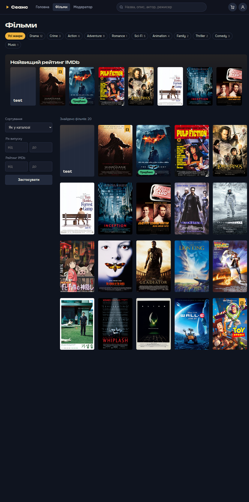
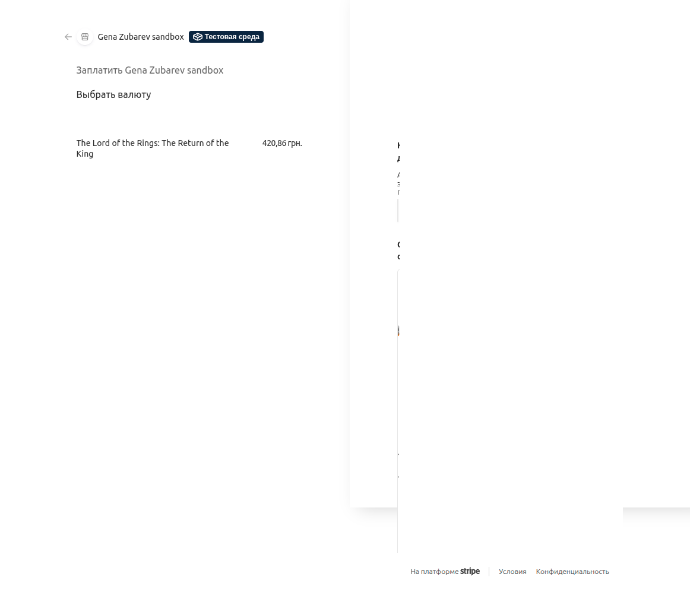
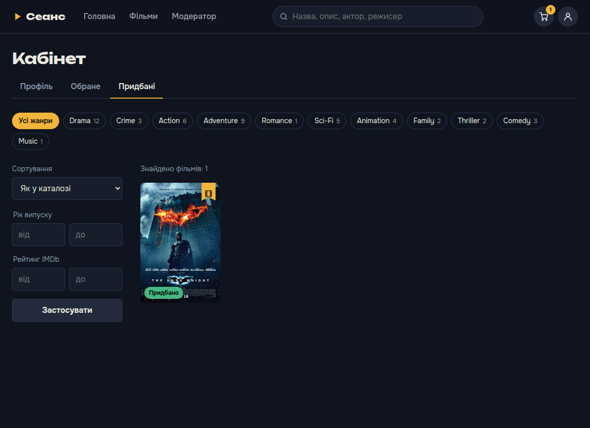
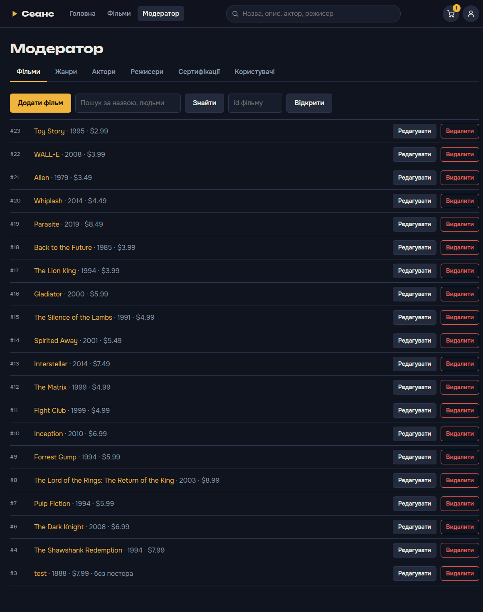
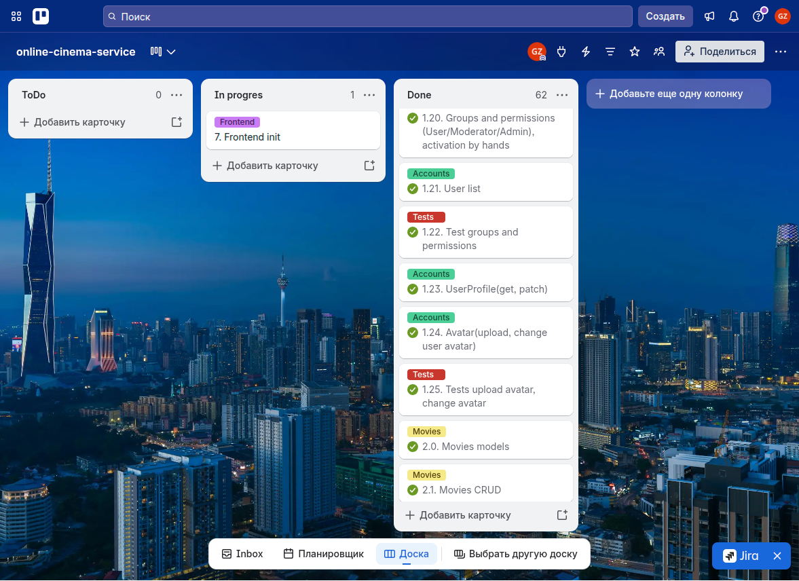

# Online Cinema

An online cinema: users register, browse a movie catalog, add movies to a cart
and buy them through Stripe. Moderators manage the catalog, admins manage users.

Monorepo: FastAPI backend + React frontend, the whole stack runs with Docker Compose.


## Features

- **Accounts** — registration with email activation (link valid 24 h, can be resent),
  JWT login (access token + refresh token in an httpOnly cookie), logout, password
  change and reset by email, profile with avatar.
- **Roles** — `user`, `moderator` (+ catalog management), `admin` (+ user groups,
  manual activation).
- **Catalog** — pagination, filters (year, IMDb, genre), sorting (price, year,
  popularity, IMDb), search by title, description, actor and director; genres with
  movie counts.
- **Movie page** — likes / dislikes, 1–10 rating, comments with replies and comment likes,
  favorites.
- **Cart → order → payment** — purchased movies cannot be added again, the order keeps
  the price at the time of ordering, payment via Stripe Checkout, confirmation by
  Stripe webhook, email receipt, "Purchased" list.
- **Moderator panel** — movies (with posters), genres, actors, directors,
  certifications; a purchased movie cannot be deleted.
- **Background tasks** — Celery sends emails; Celery Beat removes expired tokens and
  abandoned unpaid orders.

## Tech stack

| Part | Technologies |
|---|---|
| Backend | Python 3.12, FastAPI, SQLAlchemy 2 (async) + Alembic, PostgreSQL, Pydantic v2 |
| Background | Celery + Celery Beat, Redis |
| Payments | Stripe Checkout + webhooks |
| Files | MinIO (S3 API, boto3) — avatars and posters |
| Email (dev) | Mailpit |
| Frontend | React 19, TypeScript, Vite, React Router, TanStack Query, CSS Modules |
| Quality | pytest (coverage ≥ 95 %), flake8, black, mypy (strict); ESLint, Prettier |
| Infrastructure | Docker Compose, GitHub Actions (backend and frontend CI) |

## Quick start

Requirements: Docker with Docker Compose. For payments — a free
[Stripe](https://stripe.com) account (test mode) and the
[Stripe CLI](https://docs.stripe.com/stripe-cli).

**1. Environment file**

```bash
cp backend/.env.sample backend/.env
```

In `backend/.env` set:

- `SECRET_KEY` — a long random string:
  `python3 -c "import secrets; print(secrets.token_urlsafe(64))"`
- `STRIPE_SECRET_KEY` — your `sk_test_…` key (Stripe Dashboard → Developers → API keys);
- `STRIPE_WEBHOOK_SECRET` — see [Payments in development](#payments-in-development).

The rest of the values work for local development as they are.

**2. Start the stack**

```bash
docker compose up -d --build
```

Migrations run automatically (the one-shot `migrate` service), including the
`user` / `moderator` / `admin` groups.

**3. Create the first admin**

```bash
docker compose exec web python -m commands.create_admin admin@example.com
```

Asks for a password (same rules as registration: 8+ characters, an uppercase and a
lowercase Latin letter, a digit and a special character). If the user already exists,
it becomes an active admin and keeps its password.

**4. Demo data (optional)**

```bash
docker compose exec web python -m commands.seed_movies
```

Adds 20 movies with genres, directors, actors and posters
(`backend/commands/seed_posters/`). Safe to run again: existing movies are skipped.

## Addresses

| What | URL |
|---|---|
| Website | http://localhost:3000 |
| API | http://localhost:8000/api/v1 |
| Swagger UI / ReDoc | http://localhost:8000/docs · http://localhost:8000/redoc |
| Mailpit (all outgoing emails) | http://localhost:8025 |
| MinIO console | http://localhost:9001 (`MINIO_ROOT_USER` / `MINIO_ROOT_PASSWORD`) |

In development every email (activation, password reset, payment receipt) goes to
Mailpit, not to a real mailbox.

## Payments in development

Stripe cannot reach `localhost`, so the Stripe CLI forwards webhook events:

```bash
stripe login
stripe listen --print-secret        # put this value into STRIPE_WEBHOOK_SECRET
docker compose up -d web            # re-read .env (restart does not)
stripe listen --forward-to localhost:8000/api/v1/payments/webhook
```

Keep `stripe listen` running while testing payments. Test card: `4242 4242 4242 4242`,
any future date and CVC. Without the webhook the payment succeeds in Stripe, but the
order stays unpaid on the site.

## Screenshots

| Catalog | Movie page |
|---|---|
|  |  |

| Cart and unpaid orders | Stripe Checkout |
|---|---|
|  |  |

| Purchased movies | Moderator panel |
|---|---|
|  |  |

**API documentation (Swagger UI)**


## Project management

The work was planned and tracked on a Trello board: one card per step, labeled by
module (Accounts, Movies, Tests, Frontend, …), moved ToDo → In progress → Done.



## Project structure

```
online-cinema-service/
├── backend/
│   ├── src/              # accounts, movies, cart, orders, payments, storage, emails, tasks
│   ├── alembic/          # migrations
│   ├── commands/         # create_admin, seed_movies (+ seed_posters/)
│   └── tests/            # unit + integration
├── frontend/             # React SPA (see frontend/README.md)
├── docker-compose.yml
└── .github/workflows/    # backend.yml, frontend.yml
```

## Tests and checks

Backend (from `backend/`, needs the `db` container and a test database once):

```bash
docker compose exec db createdb -U cinema cinema_test
poetry install
poetry run pytest --cov
poetry run flake8 . && poetry run black --check . && poetry run mypy .
```

Frontend (from `frontend/`):

```bash
npm ci
npm run lint && npm run format:check && npm run build
```

The same checks run in GitHub Actions on every pull request.

## Notes

- The project covers a selected part of the original specification: the full path
  *catalog → cart → order → payment → purchased movies*. Admin views of orders and
  payments, refunds, order cancellation and notifications are not implemented.
- The API docs are open without authorization in development.
- Deployment (production images, nginx, HTTPS, AWS EC2) is the next stage.
- Movie posters in `backend/commands/seed_posters/` are taken from Wikipedia and are
  used for demonstration only; the rights belong to their owners.

## License

[MIT](LICENSE)
